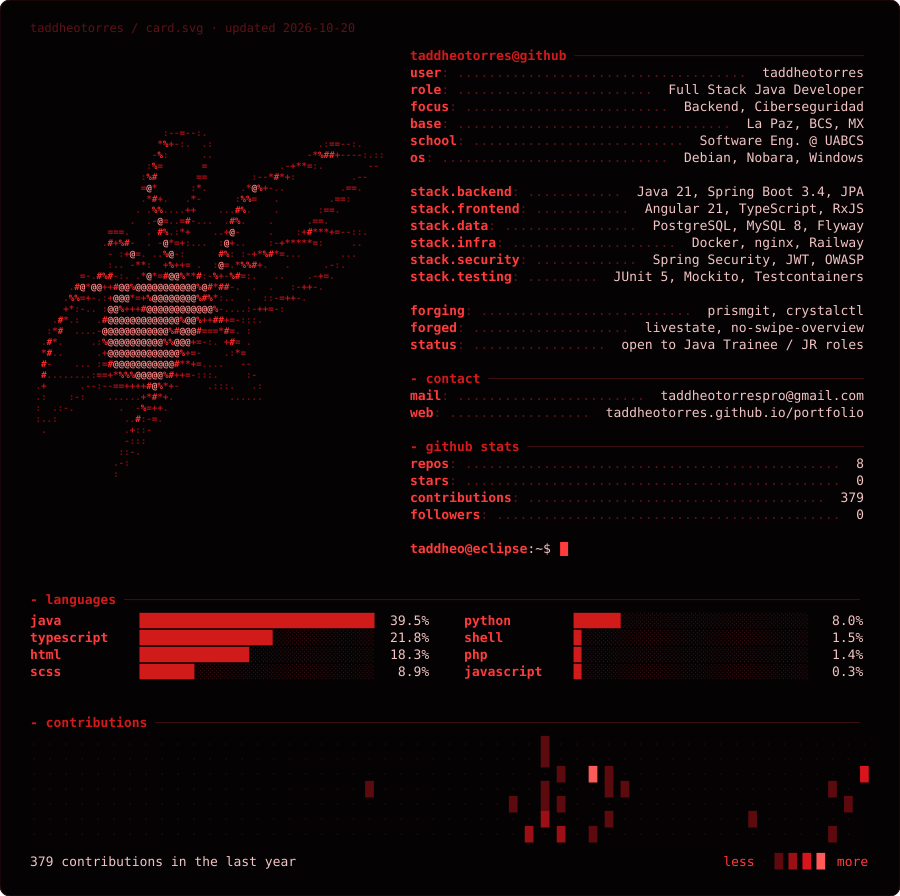

---



---

[](https://taddheotorres.github.io/portfolio/)
[](https://www.linkedin.com/in/taddheo-torres-a5420227b/)
[](mailto:taddheotorrespro@gmail.com)

---

### projects

**honeypot-api** · *señuelo REST desplegado en Railway que registra ataques en tiempo real*
`Java 21` `Spring Boot 3.4` `WebSocket (STOMP)` `JPA` `PostgreSQL` `Angular 21` `nginx` `Railway` `Docker`
```
POST /api/iniciar-sesion   →  brute force
GET  /api/productos?id=    →  SQL injection
GET  /api/buscar?q=        →  XSS
GET  /api/usuarios         →  no auth
```
[dashboard en vivo](https://honeypot-api-production-a5bc.up.railway.app) · [diagnostico](https://honeypot-api-production-a5bc.up.railway.app/diagnostico) · [view on github](https://github.com/taddheotorres/honeypot-api)

**livestate** · *SaaS de gestión inmobiliaria con pagos y chat en tiempo real*
`Java 17` `Spring Boot` `Angular` `MySQL 8` `Stripe` `JWT` `WebSockets` `Docker`
```
backend/  →  Spring Boot + JPA + JWT + Stripe + WebSockets
frontend/ →  Angular + TypeScript + RxJS
docker/   →  MySQL 8 + Docker Compose
ci/       →  GitHub Actions + Testcontainers
```
[view on github](https://github.com/taddheotorres/livestate)

**prismgit** · *dashboard analítico que narra la historia visual de un repo Git*
`Java 21` `Spring Boot 3.4` `Angular 19` `JGit` `Flyway` `PostgreSQL` `Swagger` `Docker`
```
14 REST endpoints    →  repos, commits, analytics, stories
frontend dashboard   →  stats, timelines, heatmaps, story viewer
JGit + GitHub API    →  sync commits from local or remote repos
Swagger docs         →  interactive API docs at /swagger-ui.html
100+ tests           →  JUnit/Mockito (backend) + Jasmine (frontend)
```
[view on github](https://github.com/taddheotorres/commitstory) · [live demo](https://prismgit-production.up.railway.app)

**no-swipe-overview** · *extensión GNOME Shell que bloquea el swipe al overview*
`JavaScript` `GNOME 48` `GJS`
[view on github](https://github.com/taddheotorres/no-swipe-overview)

---


```
❯ echo $CONTACT
taddheotorrespro@gmail.com
```
